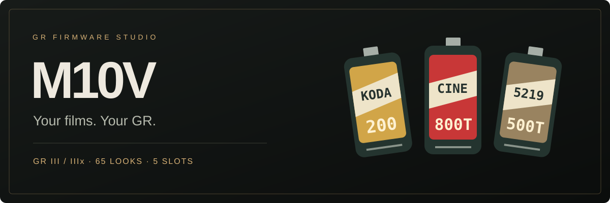
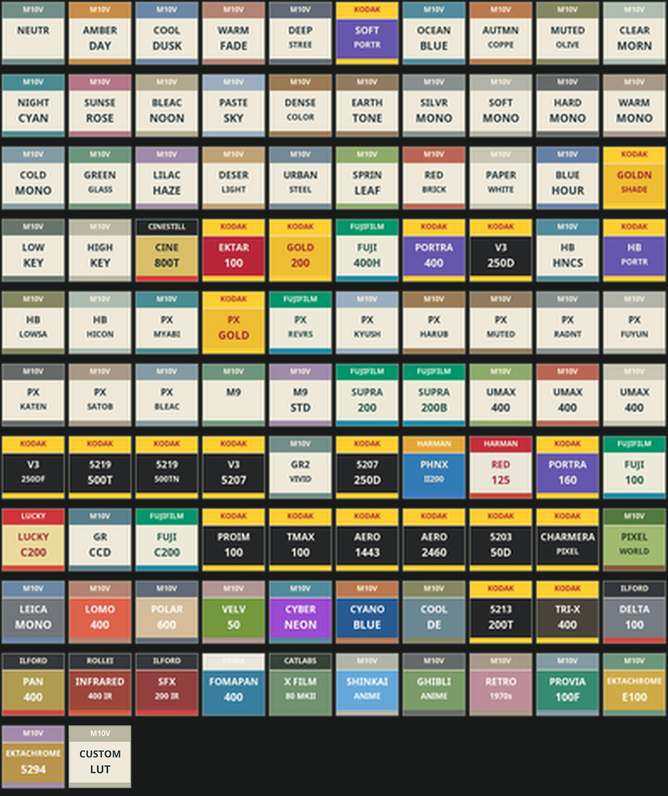

<div align="center">



**你的胶卷，你的 GR。**

面向 **RICOH GR III / GR IIIx** 的原生胶卷工作台，并提供 **GR IV** 原厂编辑工具和 **GR II** 固件检查。

[功能](#功能) · [开始使用](#开始使用) · [名字的故事](#名字的故事) · [开发与验证](#开发与验证) · [致谢](#致谢)

</div>

> **当前状态：待实机验证。** 网页、固件构建与 ARM 执行检查已完成，但修改固件的刷入、启动、菜单显示和成像仍需真实相机验证。刷入可能导致无法启动、数据丢失或设备损坏（变砖），且无法保证恢复。

## 名字的故事

在 GR III 官方固件内部的 Linux 根文件系统中，`/etc/hostname` 写着四个字符：`m10v`。

拿起 GR 时，我们关注镜头、色彩与快门；沿着固件往里走，还能看见这些体验背后的代码和配置。M10V 沿用了这个小小的内部名字，把它带到界面上，成为选胶卷、调质感、建立自己影像方案的工作台。

**从读懂相机开始，最后回到拍照本身。**

[查看名字来源的固件证据](docs/research/m10v-name-origin.md)

## 功能

| | 你可以做什么 |
| --- | --- |
| **胶卷库** | 65 套预设共用一个目录，配置五个活动槽位，在机内换卷 |
| **胶卷图标** | 原创 40×40 胶卷罐图标，网页与固件使用相同像素；800T 为红色 |
| **颗粒与柔光** | 每槽独立设置关闭、弱、中、强 |
| **800T 光晕** | GR III 在【图像控制】按 FN，用中文菜单调节五项参数：光晕强度、扩散范围、高光阈值各 0–8，颗粒和柔光各关闭、弱、中、强；网页另可配置光晕档位 |
| **时间戳** | 日期或日期与时间，可选格式、位置和颜色，使用相机时钟 |
| **统一工作台** | 导入后自动识别机型，设置方案，确认风险，再保存对应固件 |
| **配置编辑** | 搜索与分类筛选、五槽同步、草稿、撤销／重做、取消构建 |



### 支持机型

| 机型 | 当前官方核验样本 | 导出文件 |
| --- | --- | --- |
| **GR III** | Street Edition 2.10 | `fwdc239b.bin` |
| **GR IIIx** | 1.60 | `fwdc243b.bin` |
| **GR IV** | 1.11（内部 1.11.10.7）；原厂编辑器，原生胶卷库仍在移植 | `fwdc248b.bin` |
| **GR II** | 3.00；组件、资源与原样往返只读检查 | 修改导出未开放 |

GR III 工作台支持配方参数、原厂名称与图标、负片颗粒、RAW 降噪、画幅比例和水平仪等工具；GR IV 的自定义槽位编辑在独立编辑器中提供。工作台按机型显示可用状态。

GR IV 使用独立编辑区，支持参考核心的自定义滤镜参数、名称与图标、裁切和关机图案；不表示 GR III 的 65 卷原生 JPEG 运行体已移植。GR II 已解析嵌套 UNITY 容器和 121 项资源，但修改后的更新校验与原生接口尚未证明。[查看两款机型的逆向证据](docs/research/gr4-gr2-port-evidence.md)。

### 使用边界

- 胶卷效果处理保存的静态 **JPEG**。取景画面与机内 RAW 再开发暂未接入；RAW 原始像素受保护，DNG 内嵌 JPEG 预览需单独验收。
- 目录含 33 套 M10V 风格和 32 套已有模拟预设，不保证与其他实现的成像逐像素一致。
- 首次没有有效 M10V 记录时使用网页配置；已有机内记录优先，网页配置不会自动覆盖已有机内设置。
- 原厂工具方案与原生胶卷库方案分开构建；切换方案会保留草稿，暂不叠加两套运行区。
- 胶卷库随固件内置，无需 `FILMS.GRF`、授权码或外部图片文件。

## 开始使用

### 1. 准备环境

需要 **Node.js ≥ 20、Python 3 和 LLVM clang**。Node 服务使用内置模块，无需 `npm install`。

```bash
git clone https://github.com/zhaoo/m10v.git
cd m10v
git switch develop
python3 -m venv .venv
```

macOS 可通过 Homebrew 安装 LLVM：

```bash
brew install llvm
```

GR IV 参考编辑器还需要 LLD：`brew install lld`。导入后可在设置中查看编译、链接和 ARM ELF 预检结果。

构建器会查找 Homebrew 的 LLVM；其他安装位置可用 `M10V_LLVM_CLANG` 指定 **clang 的完整路径**。

### 2. 放入官方固件

官方固件不随仓库分发。自行准备与当前核验样本完全匹配的官方文件：

```text
bin/
├── fwdc239b-gr3-official.bin       # GR III Street Edition 2.10
├── fwdc243b-gr3x-official.bin      # GR IIIx 1.60
├── fwdc248b-gr4-officical.bin      # GR IV 1.11，保留现有本地文件名
└── rg2_v003/rg2_v003.frm           # GR II 3.00
```

部分历史测试仍读取根目录别名，可创建符号链接：

```bash
ln -s bin/fwdc239b-gr3-official.bin fwdc239b-offical.bin
ln -s fwdc239b-offical.bin fwdc239b.bin
```

### 3. 打开工作台

```bash
npm start
```

按终端显示的地址打开浏览器。macOS 也可双击 `start.command`。

**导入固件 → 设置方案 → 保存固件**

先选槽位，再选胶卷与质感。点击「保存固件」时阅读风险提示，明确确认后才会开始构建。取消或按 Esc 不会生成文件；每次保存都要重新确认。

> 服务器监听 loopback；配置 `M10V_PORT` 和 `M10V_PUBLIC_ORIGIN` 后可通过 Nginx 反向代理。不能只上传静态 web 目录。Ubuntu 24.04 + 宝塔的具体步骤见 [部署指南](deploy/README.md)。

<details>
<summary><strong>GR III 原厂工具的可选兼容运行时</strong></summary>

原生胶卷库采用本仓库 C/ARM 实现，不依赖外部胶卷包或 GRLife 兼容运行时。部分原厂工具仍使用锁定的兼容运行时，它不纳入源码仓库：

```bash
node scripts/sync-grlife-runtime.mjs
```

该路径需要 Python 3.12；可通过 `M10V_PYTHON` 指定解释器。GR IV 参考核心及其 Python 依赖保留在 `vendor/gr4/`。为保持源码仓库轻量，三份大体积 GR IV 校准 DNG 样片留在本机，不随 Git 分发；启用相关校准测试前，需从参考项目恢复，文件名与哈希见 `vendor/gr4/PROVENANCE.json`。各模块来源与许可见 [第三方说明](THIRD_PARTY_NOTICES.md)。

</details>

## 开发与验证

**`develop`** 为日常开发分支，**`main`** 为正式源码分支。分支名不表示固件已通过实机验收。

```bash
# JavaScript、API、固件容器和导出检查
npm test

# 原生运行体、ARM 执行与拍摄桥验证
.venv/bin/python -m pip install pillow capstone unicorn
.venv/bin/python -m unittest \
  tests.test_gr3_m10v_library \
  tests.test_gr3_m10v_library_arm \
  tests.test_gr3_m10v_capture

# 与网页相同构建链的命令行导出
node scripts/export_gr3_m10v_native.mjs builds/gr3-test
node scripts/export_gr3_m10v_native.mjs builds/gr3x-test --model=gr3x
```

完整样本测试需要本机官方固件；部分兼容回归还需要单独准备参考样本与运行时。官方输入、`.venv/`、`.runtime/`、`data/` 和 `builds/` 均不提交到 Git。

| 目录 | 内容 |
| --- | --- |
| `web/` | 统一工作台、胶卷目录和说明页 |
| `node/` | HTTP 服务、固件身份检查、构建与独立回读 |
| `native/gr3/` | 原生胶卷、菜单、图标、持久化与 JPEG 处理 |
| `scripts/` | ARM 编译、资源生成、导出与分析工具 |
| `tests/` | 原生和 ARM 执行测试 |
| `docs/` | 设计、逆向证据与验收记录 |

[机内功能验收](docs/testing/gr3-m10v-native-library.md) · [发布前检查](docs/testing/release-review-2026-10-14.md) · [第三方说明](THIRD_PARTY_NOTICES.md)

## 致谢

感谢 **gr-custom-tool、GRLife、gr3-film-mods、darkslide-gr** 在 GR 固件研究、胶片模拟与定制工具方面的公开探索。

M10V 的界面与胶卷图标采用自己的设计。使用和移植的第三方代码、数据保留对应来源与许可；详情见 [THIRD_PARTY_NOTICES.md](THIRD_PARTY_NOTICES.md)。项目源码采用 [GPL-2.0](LICENSE)。

---

<div align="center"><sub>从相机里的一个名字，到你自己的影像工作台。</sub></div>

GR II、GR IV 与 GR III 使用一致的三步工作台：导入固件 → 设置方案 → 保存固件，并共享方案清单与机型导航。GR II 当前展示只读组件与资源，修改固件保存保持禁用；GR IV 在方案页提供现有原厂影像控制、裁切与关机画面编辑。
