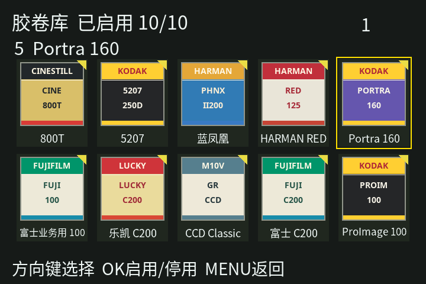

# 2026-10-23 胶卷库文字遮挡与启用标记修复

本轮用户要求仔细修复照片中的文字遮挡，并明确要求修复后直接发布 GitHub / 宝塔；随后指定将勾选框改为右上角小三角。本次据此直接执行发布，未把离线结果记作相机验收。

开发基线为已部署的 `197a6f11814c066a1886f0ba7bd1b6e5928d68e5`。原工作区另有大量未提交开发，全部保留；修复在独立工作树完成。

## 根因与结果

原十卡页面在 128×22 的区域使用原厂资源文字控件。文字没有随卡片缩小，纵向超过区域，长名称横向跨卡；第二排名称 y=376 与错误区域 y=378 重叠，底部提示 y=416 / 高36也不足以容纳默认原厂字形。旧预览用电脑字体和旧五卡 geometry，未覆盖相机实际绘制合同。

修复保留 120×120 包装，下面增加独立 120×28 名称带，名称像素纳入卡片自己的 120×148 RGBA 缓冲，不再叠原厂大字。87 个原名全部保留，无缩写；55 个可见新胶卷使用固定 Noto Sans CJK SC 字形，隐藏的历史 1–32 使用共享 ASCII 字形。自定义卷使用自己的完整名称并按宽度缩放。标题详情及底部提示保留原生控件。

首排图像 y=100，第二排 y=260，第二排图像结束408，提示栏 y=432 / 高40。名称与相邻行、提示栏分离。启用及保存错误在胶卷页标题提示，避免覆盖卡片名称。当前焦点保留黄色外框；已启用卷改为16像素右上实心三角。

## 资源、内存与功能保护

- 字形覆盖固定在源码中，记录字体 URL、SHA-256 和 OFL；构建不联网、不依赖服务器字体。
- 原 ASCII 包装字形无损 PackBits 压缩，95 个字形逐字节往返一致；名称使用四级抗锯齿与 PackBits。资源独立存入只读 RTOS 区域，保留 ELF 64 KiB 代码预算及总增长 1104 KiB 限制。
- 十张卡片及描述符由页面堆拥有，共710580字节；新增名称带增加134400字节。53个控件及独立 HEAP=55 一起重新编译。销毁先清控件再释放像素；OOM保留原图标回退。
- 胶卷ID、启用容量、顺序、存档与成像参数不变。IIIx的五卷上限和IV独立页面保持；GR II 使用独立 compat/gr2-v1 ABI。

## 已完成验证

- 新回归先在原代码复现失败，再修复通过：两行布局与提示栏分离、87卷文字带与边界、实心三角形、自定义长名称、错误提示及重复绘制复用、原包装像素一致、卡片OOM回退。
- 独立审查：95字形无损、55个压缩名称恰好展开3360像素；87内建卷和自定义卷除启用标记区域外的原120×120包装逐像素一致；53个控件逐项分配失败、卡片OOM与销毁清理均通过。
- 87款原包装合并SHA-256：`f5f9b281122cdf8974fcc97341358c79034fc13a5595aa2a49ac5dbf7cb6def0`。
- GR III 完整生产调试组合构建及独立回读通过：147个hook，RTOS增长1123276字节，保留原1130496字节上限。固件SHA-256：`a654093660f2ee7bceb22bf5f0406f7aba7d8c258e3b481484c1284de555fb96`，build_id `49a51d91`。
- GR IIIx 完整组合独立回读通过：型号、CPU与外层标识保持，固件SHA-256：`95b3f37ee7d75d3de6255f397f9625c51944dc1ee0cfa878daa4e56497b74a1d`。
- GR IV 正式构建及独立回读通过：固件SHA-256：`f52ec70d2d6b89e41638c2f5e6287b63c7c930c754e19d541e6a512e6f7e1166`。
- 部署保护Node 11项通过；Python部署、封包与界限检查通过；changelog新增版本检查通过。系统Python3.9及项目Python3.12均可生成固定资源。
- 完整 `npm test` 在修复前及修复后同环境各运行：324项，248通过、50失败、26跳过，失败名称相同。既有失败涉及五槽v4旧断言、兼容包fixture、旧前端流程和缺失参考数据；没有将其写成全套通过。名称见[完整基线失败记录](gr3-library-typography-baseline-failures-20261023.txt)。最终资源压缩后补齐本机兼容运行时并再跑完整套件：324项，254通过、45失败、25跳过；失败集合为上述基线子集，没有新增失败。

未执行相机刷入、LCD实拍或菜单响应时间测量。图中卡片、名称和三角为真实绘制代码的像素，页头/底部提示为电脑字体近似，不能称作相机截图。

